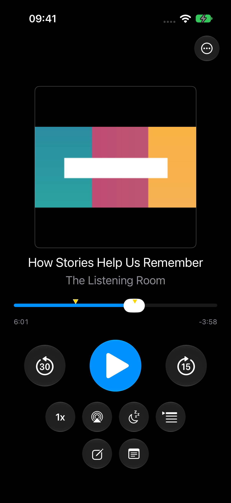
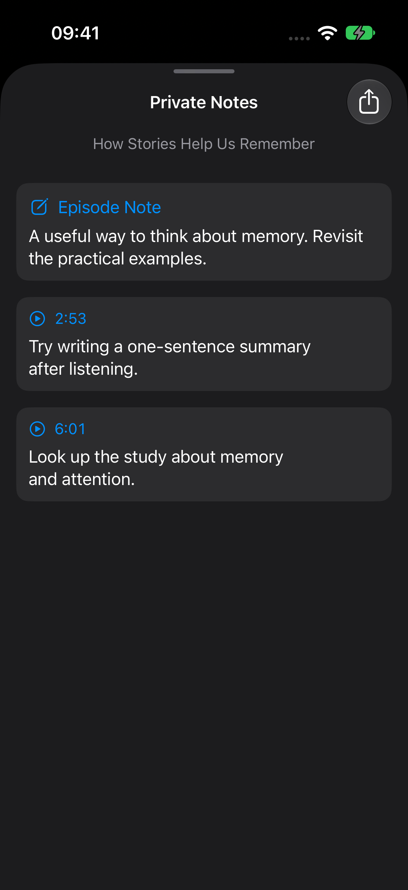
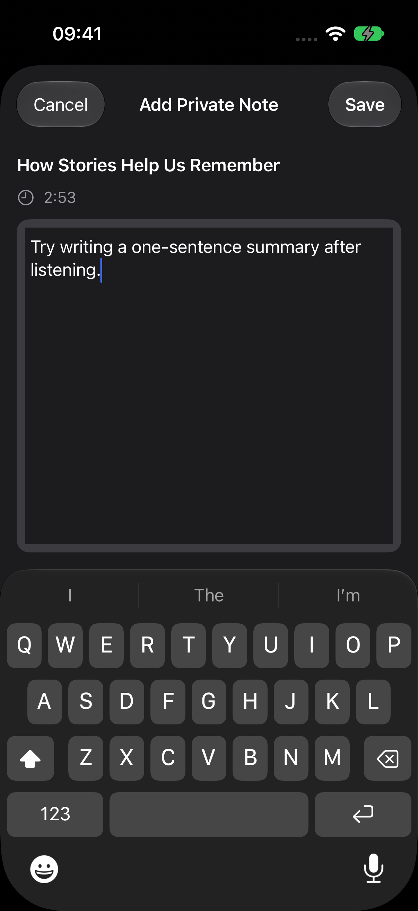
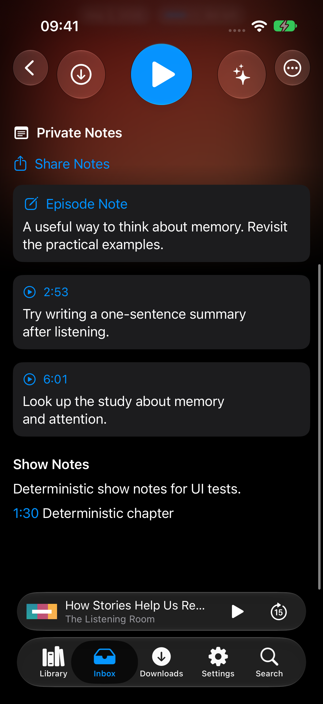
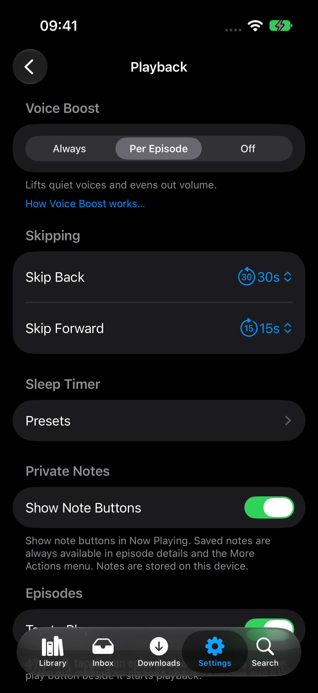

# Add Private Notes for podcast episodes

Add a place to save personal thoughts while listening, then return to the relevant part of an episode.

- Save timestamped notes from Now Playing, plus one note for the whole episode.
- Edit and delete notes, tap timestamps to play from that point, and see note markers on the progress bar.
- Add optional note buttons in Playback settings. Notes remain accessible from the playback menu and appear in episode details whenever they exist.
- Share notes as text, with formatted headings when exporting to Apple Notes.
- Keep notes on the device, with an option to delete all private notes in Settings.

Adding a note pauses playback. Saving or cancelling resumes it only if the editor paused it and no other action has since changed playback.

## Validation

The app and test targets build. All 164 selected unit tests and three device UI scenarios passed, along with the playback/chapter package tests and the UI test manifest check.

## Known edge cases

An episode ID change during editing can leave a new note attached to the old ID, or let a stale edit overwrite text merged by that change.

## Screenshots

Sample episode and notes captured in the iPhone 17 Pro simulator.

| Now Playing and note markers | Private Notes |
| --- | --- |
|  |  |

Adding a note, episode details, and settings

